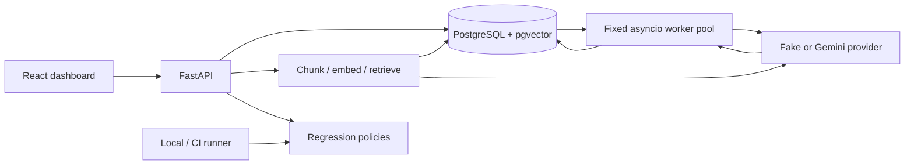

# AgentEval architecture

AgentEval is a modular monolith: one Python codebase, a FastAPI API, a separate bounded asyncio worker, PostgreSQL/pgvector, and a React dashboard. No broker or agent framework is required.

The small codebase uses modules rather than empty package layers:

| Boundary | Implementation |
|---|---|
| HTTP validation/serialization | api.py, persistence_schemas.py |
| Evaluation contracts/rules | domain.py, service.py |
| Provider interface and wiring | providers.py, runtime.py |
| Gemini integration | gemini.py, official async Google GenAI SDK |
| Database mappings/access | models.py, database.py, explicit migrations 0001–0004 |
| Durable execution | jobs.py, worker.py |
| RAG evaluation target | rag.py |
| Regression and judge analysis | regression.py, judge_validation.py |
| Benchmark | benchmark.py, reports/benchmark.json |
| Dashboard | frontend/src |

A queued request commits a run and all jobs, then returns 202. A worker claims one eligible job per available lane in a short SKIP LOCKED transaction, commits its lease, calls the provider outside a transaction, validates output, then commits a fenced result and terminal transition together. Retries/eligibility and deadlines persist. Recovery revisits expired claims; provider work can repeat after a crash. This is not exactly-once external execution.

The API also retains stateless /evaluations and synchronous /runs for small inspections. Only /queued-runs is crash-recoverable. RAG ingestion/evaluation remains request-scoped. Provider construction is shared without importing routes into workers. Domain evaluation does not depend on HTTP; infrastructure handles database/provider details.

Important trade-offs: admission serializes under a database advisory lock, completion aggregates serialize within a run, exact vector search targets a small corpus, and concurrency is process-local. PostgreSQL transactions simplify correctness at the cost of measured database overhead. Production authentication, multi-tenancy and large-scale approximate vector search are intentionally outside this local demonstration.

Primary risks remain duplicated external costs, misleading/noisy judges, and concurrency amplification across processes. Unique submissions, fenced writes, strict schemas, explicit simulation labels, compatible-run checks, finite attempts and bounded consumers address concrete parts of these risks. Human calibration and live-provider behavior still need actual evidence. See ENGINEERING_DECISIONS.md, JOB_EXECUTION_SEMANTICS.md and KNOWN_LIMITATIONS.md.
