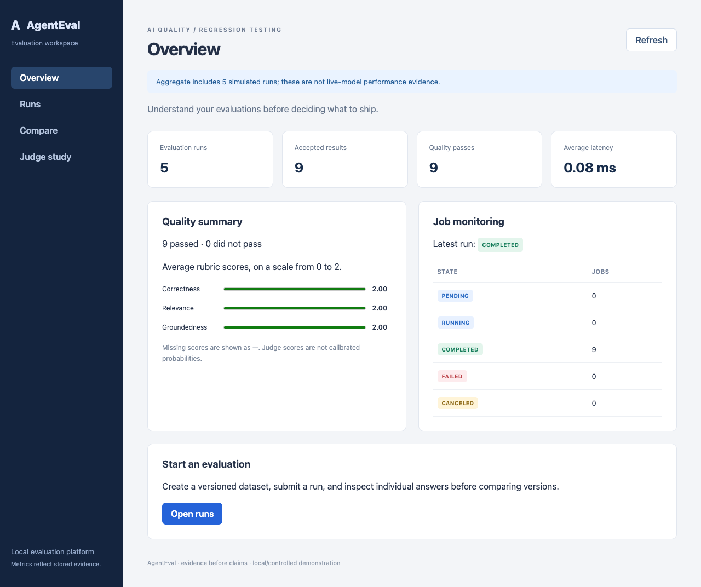

# Local portfolio demonstration

Use the simulated Compose stack on loopback. This demonstration creates a two-case dataset, two queued runs and four accepted fake results, verifies submission replay, and compares the equivalent completed runs. It makes no paid requests and creates no human labels. The accepted results show queue mechanics, not AI accuracy. [Observed demo evidence](../reports/portfolio-demo.json) records the successful local run.

## Prepare once

For the demo-first path, start your local Docker engine and run from the repository root:

```bash
python3 scripts/run_demo.py
```

Python 3.12+ and Docker Compose are the only host prerequisites for this launcher; it needs no host Node installation, Python packages or API key. The first build needs network access for pinned images/dependencies. It builds the packaged dashboard/API, starts a separate `agenteval-demo` project at `http://127.0.0.1:8013/dashboard/`, rehearses the queued comparison and policy scenarios, and prints run IDs plus a fresh evidence path. It leaves the stack running for presentation. Use `--port` if 8013 is occupied.

The launcher refuses remote/TCP Docker contexts, live providers, published database ports, non-loopback API binding and an existing project from another checkout or protected profile. Rerunning it stops/rebuilds only its own fake API/worker, preserves its named database volume and earlier evidence, and creates new demonstration runs. Finish any active presentation before rerunning. It never deletes data or alters the separate Gemini/private-server projects. Existing failed/pending demo runs remain available for inspection; do not reset data to hide a failed rehearsal.

To stop the demo while preserving its data:

```bash
docker compose -p agenteval-demo --env-file .local/compose.env -f compose.yaml stop api worker db
```

Do not add volume-deletion flags. Run the launcher again when ready to present. This workflow is a local simulated demonstration, not cloud provisioning or live-model validation.

The older default-stack setup below remains available for development:

From the repository root, install Python dependencies with `bash scripts/install.sh`. With Docker running, follow [the container setup](DEPLOYMENT.md):

```bash
python3 scripts/compose_env.py
docker compose --env-file .local/compose.env build api tests
docker compose --env-file .local/compose.env up -d --wait api worker
```

The setup preserves existing credentials and database volume. Inspect existing services before replacing a running stack; stop old API/workers for schema-changing updates. Compose binds the API to `127.0.0.1:8011` and defaults to four lanes in one fake-provider worker. Do not print resolved configuration or expose the API publicly.

## Present in five minutes

With the launcher, use port **8013** in the steps below; the older default stack uses **8011**. The printed baseline/candidate run IDs and `artifacts/demo-*/report.json` identify the completed rehearsal. You can use that evidence directly without submitting another run during the presentation.

1. Open `http://127.0.0.1:8013/dashboard/` and explain immutable dataset versions, queued work and the simulated-provider label.
2. The launcher has already rehearsed this path. To submit another pair during presentation, run `python3 scripts/portfolio_demo.py --port 8013`. It first requires readiness to identify a fake, simulated provider with a ready database, before creating work. It connects only to `127.0.0.1`, bypasses proxies and refuses HTTP redirects. Use `--port` if the Compose loopback port differs.
3. Read the printed evidence-file path. Each invocation chooses a fresh ignored JSON file; explicit `--output` refuses an existing file. Inspect its dataset/run IDs in the dashboard: two completed queued runs, two cases each. Repeated invocations reuse the equivalent immutable dataset and retain new runs without deleting history.
4. Explain that replaying each submission key returns the same run and that one accepted result does not promise one external call after a crash. The demo checks one attempt per job in this controlled run; crash/recovery evidence is separate.
5. Open the launcher’s saved `report.json` and show `policy_scenarios`: equivalent fake results (PASS), a deliberately injected score regression (FAIL), and incompatible judge prompts (INCONCLUSIVE). With host development dependencies installed, `.venv/bin/python -m agenteval.regression --demo-scenarios --output artifacts/NEW-POLICY-REPORT.json` can also run the offline policy cases. Its zero latency values and altered scores are synthetic policy fixtures. Exit status zero means all three decisions matched expectations; it does not mean the deliberately failing candidate passed. CI retains this report. Equivalent fake runs in the recorded demo compare as PASS; that is not statistical accuracy evidence.
6. Show [human-study status](HUMAN_LABELING.md): fifty completed human labels; the archived v1 baseline matched 6/10 decisions, while candidate-v2 matched 10/10 development and 40/40 response-level validation decisions. All fifty responses are paired, and the ten underlying questions still form a convenience sample. Show the two-run, single-case [live smoke record](../reports/live-gemini-smoke.json) separately from simulated benchmark and demo results; show the separate [two-document RAG smoke](../reports/live-rag-smoke.json), which validates one controlled query only.

If readiness fails or the worker is absent, diagnose the local stack; do not switch to Gemini to make the demo pass. On a worker timeout the script leaves its persisted run intact for inspection. It does not cancel work, delete data, restart services, rotate credentials or expand any paid budget. The preflight depends on truthful server configuration; it is not a distributed spending control or protection against an operator changing configuration mid-run.

For the host-only API on port 8000, start one fake worker with `AGENTEVAL_WORKER_CONCURRENCY=4` using the README's local database workflow, then use `--port 8000`. Do not mix an older worker process with a replacement.

For failure/recovery, present committed controlled evidence or use dedicated tests against `_test`; do not terminate the development database. Historical benchmarks and the lock outlier remain in their original reports. See [next validation boundaries](NEXT_VALIDATION.md) for live RAG and deployment safeguards. No public deployment is part of this demonstration.

## Presentation boundaries and next hardening work

Show these as three separate evidence types: the running fake queue/comparison workflow; the explicitly synthetic PASS/FAIL/INCONCLUSIVE policy cases; and the recorded fifty-response Gemini judge study. The last matched all fifty frozen human decisions, split into ten development and forty response-level validation responses across only ten underlying questions. It is not fifty independent questions or general model accuracy. The eight-question live RAG collection is saved, but its genuine human answer/citation/abstention review remains pending.

After the demo milestone, continue with that human review, new-question/repeated-run evaluation under a separately approved budget, recurrence capture for the unresolved historical PostgreSQL timeout, and approved server/backup operations. Private hosting remains unprovisioned. Local admission controls and encrypted restore checks are verified safeguards, not a claim that every failure mode has been eliminated.

## Verified rehearsal

Two launcher rehearsals completed successfully. The first two completed runs and their four accepted fake results remained readable after the second launcher restart. The packaged dashboard browser workflow passed with fifty recorded study pairs displayed. All 225 container tests passed; evidence and source fingerprints are in [demo readiness verification](../reports/demo-readiness-verification.json). The screenshot below is a simulated demonstration, not live-model quality or latency evidence.


